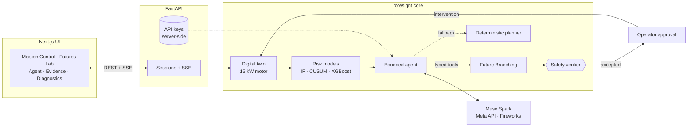

# Foresight AI

**See the failure before it happens. Simulate the future. Prevent the outcome.**

Foresight AI is a research-grade, **simulation-only** failure-prevention platform for a digital twin of an industrial electric motor. It runs a closed loop:

**Observe → Predict → Diagnose → Simulate → Verify → Recommend → Monitor**

Built for the **Meta Global AI Developer Hackathon 2026** (Indie / Push the Frontier). Meta Muse Spark powers the bounded diagnostic agent, either **Muse Spark 1.3** on the Meta Model API (`MODEL_API_KEY`) or the open-weights **Muse Spark Open** on Fireworks AI (`FIREWORKS_API_KEY`), selectable per run. With no key configured, a clearly labelled deterministic planner drives the same tools.

> This system never connects to or controls real equipment. All telemetry is synthetic.

## Why it is not a chatbot

1. **Digital twin** with deterministic seeds and physics-inspired ODEs  
2. **Calibrated ML** (Isolation Forest, change-points, multi-horizon XGBoost) trained on held-out seeds  
3. **Future Branching** — counterfactual intervention rollouts with matched noise and an explicit objective  
4. **Independent safety verifier** that can reject LLM or planner proposals  
5. **Information gate** that holds a verified action when the risk rests on weak trend evidence and waiting is safe  
6. **Bounded Meta agent** with typed tools; it cannot invent sensor readings or simulation results  

## How it works



The model only reasons over numbers returned by local tools, and every proposal must pass the deterministic verifier and an operator approval before it touches the (simulated) motor. More diagrams, including one agent run, the verifier decision tree and the red-team loop, are in [`docs/architecture.md`](docs/architecture.md).

## Quick start (local)

### Prerequisites

- Python 3.11–3.13, [uv](https://github.com/astral-sh/uv)
- Node.js 20+
- Optional: Meta Model API key (`MODEL_API_KEY`) from [dev.meta.ai](https://dev.meta.ai) and/or a Fireworks AI key (`FIREWORKS_API_KEY`) from [fireworks.ai](https://fireworks.ai)

### Backend

```bash
cp .env.example .env
# optional: set MODEL_API_KEY and/or FIREWORKS_API_KEY in .env

uv sync
uv run pytest
uv run uvicorn foresight_api.main:app --reload --port 8000
```

First API start trains or loads the risk model bundle under `artifacts/models/`.

### Frontend

```bash
cd apps/web
cp .env.example .env.local   # NEXT_PUBLIC_API_BASE_URL=http://localhost:8000
npm install
npm run dev            # or: npm run dev:webpack (if native SWC/Turbopack binaries are blocked)
```

Open http://localhost:3000

### Smoke (no UI)

```bash
uv run python scripts/smoke_pipeline.py
```

### Evaluation

```bash
uv run python scripts/run_evaluation.py                     # offline, no API calls
# live provider × reasoning-effort comparison (real API calls, costs tokens)
uv run python scripts/run_evaluation.py --live-agent-only --repeats 3 \
    --arms meta:low,meta:medium,meta:high,fireworks:low,fireworks:medium,fireworks:high
# adversarial red-team of the verifier (real API calls)
uv run python scripts/run_red_team.py --attackers fireworks:high,meta:high
```

Reports: [`evaluation.md`](artifacts/reports/evaluation.md), plus one red-team report per verifier version: [`redteam_v1.md`](artifacts/reports/redteam_v1.md), [`redteam_v2.md`](artifacts/reports/redteam_v2.md), [`redteam_v3.md`](artifacts/reports/redteam_v3.md) and [`redteam_v4.md`](artifacts/reports/redteam_v4.md). A new red-team run writes `redteam.md`. [`evaluation_pre_trigger_fix.md`](artifacts/reports/evaluation_pre_trigger_fix.md) keeps the closed-loop results from before the last agent-trigger change.

### Docker Compose

```bash
cp .env.example .env
docker compose up --build
```

Requires Docker. Primary path for judges remains `uv` + `npm` if containers are unavailable.

## Demo path (3 minutes)

1. Mission Control → scenario **Cooling degradation**, seed **7** → Start  
2. Inject fault → watch temperature / risk rise  
3. Agent → run diagnosis (Muse Spark or deterministic planner)  
4. Futures Lab → compare continue vs interventions  
5. Approve verified recommendation → observe post-intervention trajectory  
6. Evidence → real metrics; Diagnostics → API key / model check  

Script: [`docs/demo-script.md`](docs/demo-script.md)

## Repository layout

```text
apps/web/                 Next.js UI
services/api/             FastAPI + SSE
packages/foresight/       Twin, ML, branching, verifier, agent
scripts/                  Train, evaluate, smoke
tests/                    Unit + API integration
artifacts/reports/        Evaluation outputs (committed)
docs/                     Architecture, demo, submission
```

## Model providers

Both providers serve Meta's Muse Spark family through the same Responses API protocol (function tools, `text.format` strict JSON schema, `previous_response_id`, reasoning effort), so the agent, tools and verifier are identical; only the endpoint and model change.

| | Meta Model API | Fireworks AI |
|---|---|---|
| Key | `MODEL_API_KEY` | `FIREWORKS_API_KEY` |
| Base URL | `https://api.meta.ai/v1` | `https://api.fireworks.ai/inference/v1` |
| Model | `muse-spark-1.3` | `accounts/fireworks/models/muse-spark-open` |
| Reasoning effort | minimal · low · medium · high · xhigh | low · medium · high · xhigh |

`FORESIGHT_LLM_PROVIDER` picks the default; the Agent page lets you choose provider and effort per run, and each trace records both. Fireworks is also used as the **attacker** in the verifier red-team (`scripts/run_red_team.py`). Keys stay in the API process and are never sent to the browser. **Diagnostics** has a live check per provider.

**Vision / SAM 3.1:** the `inspect_visual_evidence` tool returns `unavailable`. We do not claim live segmentation without a real camera source.

## Evaluation snapshot

From the last committed report (synthetic held-out seeds; see the report for full tables and limitations):

- Calibrated XGBoost 15-min failure risk: high PR-AUC with low FPR vs alarm/z-score baselines  
- Closed-loop policies: every intervening policy had 0 failures against 10/20 with no action on the main 5 seeds. Foresight never touched a healthy episode.  
- Closed loop (seeds 2000–2004): `foresight_active` mean cost $1,647 vs `foresight_estimated` $1,765 vs the inspect-on-alarm rule $1,473 vs no-action $16,835. The same ranking holds on confirmation (2005–2014) and on a 5-seed hold-out that was never inspected (2015–2019). The inspect-on-alarm rule is still cheaper; Future Branching beats an ML-only inspect trigger; the information gate modestly lowers cost vs estimated without adding a failure. One remaining miss: a 10-minute inspection scheduled 5 minutes before episode end never finishes, so the terminal-risk penalty still applies.
- **Provider comparison** (126 live runs; Meta Muse Spark 1.3 vs Fireworks Muse Spark Open at low, medium and high effort; 7 cases × 3 repeats; verifier v2; $5.65). Regret is the agent's chosen action against the deterministic planner's, scored in one shared audit ensemble:
  - Meta's mean regret was +$3, −$4 and −$21 at low, medium and high. At high effort the 95% CI was [−$50, $0], and no run was worse than the planner.
  - Fireworks' mean regret was +$328, +$131 and +$121: it picks costlier actions.
  - In 4–6 of 21 runs per arm, Meta ended without a verified submission and the optimizer chose instead. Fireworks never needed that fallback, but 3 of its 63 runs hit the 300-second agent time limit.
  - Across all arms: 0 unsafe picks, 0 interventions on the healthy case, 0 invented evidence ids.
- **Re-check on verifier v3** (28 runs, both providers at high effort, $1.64): 28/28 completed, 0 unsafe picks, 0 healthy false alarms. Mean regret was +$0.70 for Meta and +$46 for Fireworks; both CIs include 0.
- **Re-check on verifier v4 + information gate** (28 runs, both providers at high effort, $1.71): 28/28 completed, 0 unsafe picks, 0 healthy false alarms, 0 verifier rejections. Mean regret was +$118 for Meta and +$173 for Fireworks; both CIs still include 0 (wide because of two $2,000 shutdowns). Three runs were worse than the planner and all three were safe: Fireworks shut down a cooling case, Meta shut down an overload case, and Fireworks derated an overload by 40%. One Meta run fell back to the optimizer. The information gate did not hold any of these snapshots — the live cases have supported trends (`t` ≫ 2); the gate is for post-restart spurious slopes. Fireworks invented 44 unknown evidence ids in hypotheses on 2 of 14 runs (v3 had 0); the final submissions still verified.
- **Verifier red-team.** Fireworks and Meta acted as white-box attackers: 3 adaptive rounds over 7 cases, with a random fuzzer as control. About $6.60 across four verifier versions.

  | Verifier | Attempts | Hard escapes | "Worse than nothing" / healthy escapes |
  |---|---|---|---|
  | v1 | 265 | 0 | 31 / 38 |
  | v2 | 264 | 1 | 0 / 12 |
  | v3 | 370 | 2 | 0 / 0 |
  | v4 | 366 | 3 (one distinct proposal) | 0 / 0 |

  Each round found a subtler hole, and each was fixed (see [architecture](docs/architecture.md#5-verification-foresightverification)). v4 closed the late-inspection escapes from v3. Meta then found one new proposal that the verifier accepts and the audit rejects, and submitted it in all three rounds. It is a 35 % load cut on a bearing case that fails in 1 of 48 audit members (95 % CI 0.4–10.9 %), while the verifier's 16-member confirmation saw no failures. This is tail risk below the verifier's ensemble resolution, and it is still open. One Fireworks round was lost to network timeouts and is reported as lost.
- Section 6 of the report has the full tables.

Do not treat simulator metrics as real-plant performance.

## Documentation

- [Architecture](docs/architecture.md)
- [Simulation model](docs/simulation-model.md)
- [Demo script](docs/demo-script.md)
- [Submission draft](docs/submission.md)
- [Progress checklist](docs/progress.md)
- [Risks](docs/risks.md)

## License

MIT (see `pyproject.toml`). Third-party packages retain their own licenses (NumPy, SciPy, scikit-learn, XGBoost, FastAPI, Next.js, etc.).
