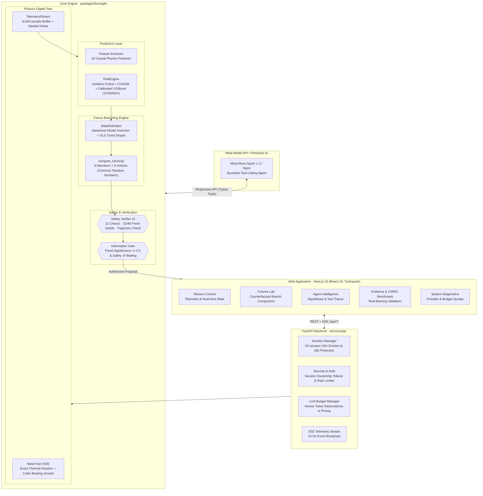

# FORESIGHT AI — FULL REPOSITORY & ARCHITECTURAL AUDIT

**Audit Date:** November 7, 2026  
**Auditor:** Principal Systems Architect & AI Safety Auditor  
**Repository Branch:** `feat/foresight-elite-upgrade-nov2026`  
**Base Commit SHA:** `106ce9b7f43a024e66818c2d7423a9faddcd3ef8` (origin/main)  
**Hackathon:** Meta Global AI Developer Hackathon 2026 (Track: Indie Developer / Push the Frontier)

---

## 1. Executive Summary

Foresight AI is a closed-loop predictive maintenance platform for a digital twin of an industrial motor drive (15 kW induction motor, class-F insulation, constant-torque conveyor). Rather than operating as an ungrounded generative chatbot, it connects an empirical/physics digital twin, calibrated XGBoost/Isolation Forest models, counterfactual simulation branching (Future Branching), and an independent deterministic safety verifier (Verifier v5) with Meta Muse Spark reasoning agents.

This deep audit evaluates every layer of the codebase:
1. Physical and mathematical foundations of the Digital Twin.
2. Machine learning calibration, anomaly detection, and horizon risk estimates.
3. Counterfactual future branching engine and state estimation.
4. Independent verification and information gating mechanisms.
5. Meta AI integration (Responses API with `muse-spark-1.3` and `muse-spark-open`).
6. FastAPI backend services (token budgets, sliding-window rate limiters, session ownership).
7. Next.js 16 (React 19) full-stack web interface.

---

## 2. Complete Architecture Map

---

## 3. Capability Inventory: Implemented vs. Simulated vs. External

| Component | Status | Implementation Details | External Credentials Required |
|---|---|---|---|
| **Physics Digital Twin** | Fully Implemented | First-principles lumped thermal ODE with exact exponential solution; cubic stress bearing spalling; Ornstein-Uhlenbeck noise. | None (100% self-contained Python/NumPy). |
| **Predictive ML Models** | Fully Implemented | Isolation Forest, two-sided CUSUM, 3-horizon XGBoost with isotonic calibration on held-out validation episodes. | None (Pre-trained `risk_bundle.joblib` or auto-train). |
| **State Estimator** | Fully Implemented | Inverts datasheet thermal and vibration equations over 40 min telemetry window to estimate hidden machine state. | None. |
| **Future Branching Engine** | Fully Implemented | Forking $N$ simulation replicas under common random numbers to evaluate counterfactual intervention trajectories. | None. |
| **Verifier v5** | Fully Implemented | 11 independent blocking checks, fresh Monte Carlo confirmation seeds ($N=32$ general, $N=48$ bearing), full trajectory vibration scanning. | None. |
| **Information Gate** | Fully Implemented | OLS slope standard error test ($t \ge 2.0$); evaluates counterfactual risk of waiting 30 min before intervening. | None. |
| **Meta Muse Spark 1.3** | Fully Implemented | Direct HTTPS client to Meta Model API (`https://api.meta.ai/v1/responses`) using structured JSON tools and reasoning effort parameters. | Requires `MODEL_API_KEY`. Deterministic planner acts as complete offline fallback. |
| **Meta Muse Spark Open** | Fully Implemented | Direct HTTPS client to Fireworks AI (`https://api.fireworks.ai/inference/v1/responses`). | Requires `FIREWORKS_API_KEY`. |
| **CWRU Real Benchmark** | Fully Implemented | Offline evaluation harness streaming 12 kHz accelerometer data from Case Western Reserve University Bearing Data Center into `RiskEngine`. | None (bundled in `artifacts/datasets/cwru_benchmark.npz`). |
| **Session Security** | Fully Implemented | Cryptographic session tokens (`secrets.token_urlsafe(32)`), HTTP-only cookies, sliding-window rate limiters. | None. |
| **Next.js Web UI** | Fully Implemented | Mission Control, Futures Lab, Agent Intelligence, Evidence & CWRU, Diagnostics. Built with Next.js 16.4.3 & React 19. | None (runs against local FastAPI). |

---

## 4. Key Architectural Weaknesses Identified

### Weakness 1 (P0): Finite-Horizon Truncation Bias in Policy Comparison
- **Mechanism:** In `interventions.py`, fixed 6-hour (`EPISODE_S = 21600 s`) episodes truncate maintenance cycles. Late-shift interventions by reactive rules spill maintenance downtime past $t=360$ min, receiving "free" uncounted downtime. Conversely, proactive proposals with a 10-minute delay right before shift end (e.g., $t=355$ min) fail to start maintenance before $t=360$ min and incur a $19,500 terminal penalty ($18,000 failure risk + $1,500 deferred maintenance).
- **Impact:** Artificially inflates Foresight Active costs on seed 2017 to $19,500 while rule inspection incurred only $650, skewing the overall holdout benchmark.

### Weakness 2 (P1): Counterfactual Peak-Temperature Under-Coverage (25% vs Nominal 80%)
- **Mechanism:** In `planning_twin_from_estimate`, initial conditions `temperature_c` and `ambient_c` are initialized deterministically with 0 perturbation. Sensor measurement noise, ambient temperature Ornstein-Uhlenbeck drift, and small sample quantile contraction ($N=16$) cause predicted $p_{10}-p_{90}$ bands to be severely under-dispersed ($\approx 2.0$ °C spread vs actual $6-8$ °C drift).
- **Impact:** Only 25% of true process peak temperatures fall within the predicted band; for latent faults, coverage drops to 9.8%.

### Weakness 3 (P0): Verifier CLI Version Registry Missing v5
- **Mechanism:** In `scripts/run_red_team.py`, `VERIFIER_VERSIONS` only defined `"v1"`, `"v2"`, `"v3"`, `"v4"`. Passing `--verifier v5` raised an `argparse` validation error, preventing automated adversarial regression runs against the latest verifier.

### Weakness 4 (P1): Missing End-to-End Meta Agent Ablation Matrix
- **Mechanism:** The evaluation report contained live model snapshots on 7 case studies, but lacked a formal 5-arm comparative ablation under identical test seeds measuring decision quality, latency, token spend, and safety rejections.

### Weakness 5 (P2): Visual Clarity of Safety Proofs in UI
- **Mechanism:** While the backend computes complete 11-check verification results, the frontend previously displayed only status chips without interactive trajectory threshold overlays, Wilson confidence interval visualizers, or mathematical certificates of proof.
