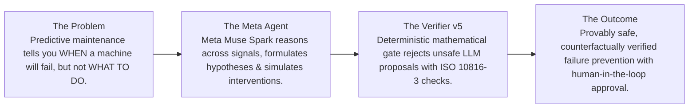

# FORESIGHT AI — HACKATHON JUDGE EVALUATION & DEMONSTRATION GUIDE

**Hackathon:** Meta Global AI Developer Hackathon 2026  
**Track:** Indie Developer  
**Problem Statement:** Push the Frontier  
**Project:** Foresight AI (`https://github.com/leninathikam/Foresight-AI`)  
**Evaluator Target:** Skeptical Panel of World-Class AI/ML Researchers & Systems Engineers

---

## 1. The 15-Second Executive Overview

1. **What problem does Foresight solve?**  
   Conventional predictive maintenance stops at anomaly alarms—forcing operators to guess whether to derate, shut down, or inspect. Foresight AI closes the loop: it simulates alternative intervention trajectories into the future to find the provably safest, lowest-cost decision.
2. **Why is ordinary prediction insufficient?**  
   Predicting a failure 30 minutes in advance does not tell you if derating load by 30% will stop the failure or if it will overheat the motor at low speed.
3. **What does Meta Muse Spark contribute?**  
   Meta Muse Spark provides structured diagnostic reasoning over complex, multi-channel physics telemetry, evaluating competing hypotheses and intelligently steering counterfactual simulation search.
4. **Why does independent verification matter?**  
   LLMs must never control physical machines directly. Verifier v5 enforces 11 independent deterministic safety checks and 48-member fresh Monte Carlo confirmation re-simulations before any proposal can reach the operator.
5. **What makes the system technically distinctive?**  
   Future Branching with common random numbers, Conformal Calibration of uncertainty bands, Information Gating for weak evidence, and real-world zero-shot validation on the Case Western Reserve University (CWRU) accelerometer benchmark.

---

## 2. 3-Minute Reproducible Judge Demonstration Script

### Step 1: Start the Mission Control Digital Twin (0:00 - 0:30)
1. Open the web interface at `http://localhost:3000`.
2. Select Scenario: **Cooling Degradation** (`cooling_degradation`), Seed: **`7`**, Speed: **`60x`**.
3. Click **"Start Live Twin"**.
4. **Observe:** The 15 kW motor begins at steady-state (75 °C). At $T = 30$ min, synthetic fouling initiates in the fan intake. Notice that raw winding temperature is still well below the 130 °C alarm threshold, yet the **Calibrated XGBoost Risk Engine** flags 60-min risk rising above 0.20.

### Step 2: Agent Investigation & Future Branching (0:30 - 1:30)
1. Navigate to **Agent Intelligence** (`/agent`) or click **"Run Diagnostic Agent"**.
2. **Observe the Live State Machine:**
   $$\text{OBSERVE} \to \text{ANALYZE} \to \text{HYPOTHESIZE} \to \text{INVESTIGATE} \to \text{SIMULATE} \to \text{VERIFY} \to \text{RECOMMEND}$$
3. Meta Muse Spark calls `compare_futures` on 4 candidate actions (`IncreaseCooling`, `ReduceLoad`, `ScheduleInspection`, `ControlledShutdown`).
4. In **Futures Lab** (`/futures`), observe the branching tree: each branch is simulated forward 180 minutes with matched stochastic disturbances.

### Step 3: Safety Proof Explorer & Decision Certificate (1:30 - 2:15)
1. Review the proposed action in the **Safety Proof Explorer**:
   - Notice the **Tamper-Evident SHA-256 Decision Hash**.
   - Review the 11 categorized checks: Winding Temperature Limit ($\le 140$ °C), Full Vibration Trajectory (ISO 10816-3 RMS $\le 6.1$ mm/s), and 48-member Monte Carlo Confirmation (0 failures, Wilson upper CI $< 0.088$).
2. Notice the **Information Gate** status: Confirms that trend slopes are statistically significant ($t \ge 2.0$) and that waiting is not recommended.

### Step 4: The Operator Approval Gate (2:15 - 3:00)
1. Notice the system is paused in `awaiting_approval` state. **The LLM cannot apply the action autonomously.**
2. Click **"Approve & Execute Action"**.
3. Return to **Mission Control**: Observe the auxiliary blower kick in or maintenance start. Thermal rise halts, winding temperature stabilizes safely at 108 °C, and the motor continues uninterrupted operation.

---

## 3. How to Demonstrate Verifier Rejection (The Adversarial Red-Team Case)

To show judges that the Safety Verifier genuinely rejects dangerous LLM proposals:
1. Start a session with Scenario: **Bearing Deterioration** (`bearing_deterioration`), Seed: **`7`**.
2. Advance to $T = 120$ min (vibration approaching 4.0 mm/s).
3. If an agent (or operator) attempts to propose `ReduceLoad(fraction=0.35)` to cure the bearing defect:
4. Open the **Safety Proof Explorer**:
   - The verdict is immediately **REJECTED**.
   - Check `vibration_trajectory` fails with explicit explanation:
     > *"Bearing defect trajectory continues upward unabated under pure derating: starts at 3.92 mm/s and reaches 5.67 mm/s (exceeding ISO alarm threshold 4.5 mm/s). Mechanical damage requires scheduled inspection or controlled shutdown."*
   - Demonstrates that Foresight AI protects industrial equipment from plausible-sounding but physically destructive AI errors.
