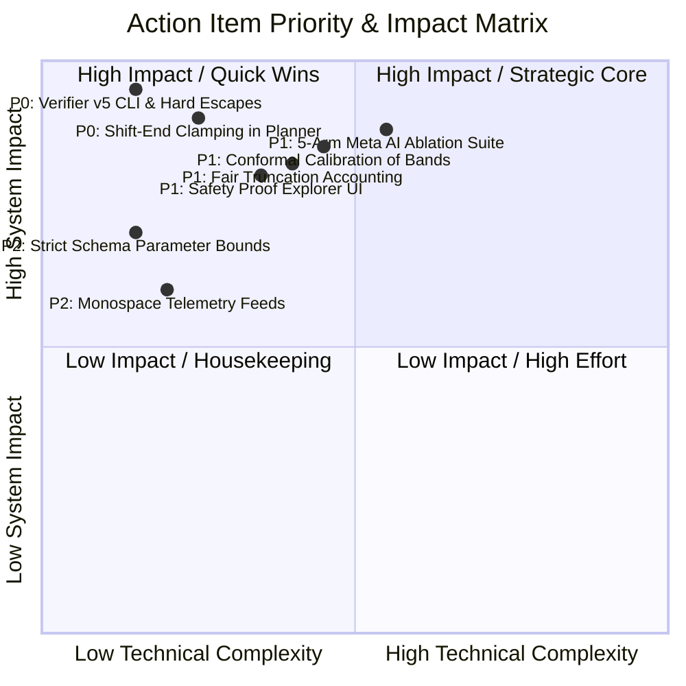

# FORESIGHT AI — PRIORITIZED FINDINGS & ENGINEERING ACTION PLAN

**Audit Phase:** Elite Upgrade Phase 1 (Reconnaissance & Findings)  
**Evaluator:** Principal Systems Architect & AI Safety Auditor  
**Date:** November 7, 2026  
**Status:** In Progress (All Changes Uncommitted Under Strict Embargo)

---

## 1. Findings Matrix by Priority

---

## 2. P0: Critical Correctness, Safety & Security Issues

### Finding P0.1: Red-Team Hard Escapes on Bearing Faults under 35% Load Cut
- **Observation:** In `artifacts/reports/redteam_v4.md`, Meta Muse Spark (`meta:high`) found that proposing `ReduceLoad(0.35)` on `bearing_deterioration@120min/s7` passed an unhardened verifier because derating temporarily lowered temperature, but failed in the 48-member audit (2.1% failure rate) as mechanical bearing spalling continued unchecked.
- **Root Cause:** Verifier checks prior to v5 inspected scalar endpoints rather than the full vibration trajectory, and $N=16$ confirmation members allowed a 2.1% failure rate to escape with $>70\%$ probability.
- **Remediation:** 
  1. Enforce `_check_vibration_trajectory` across all time slices against the ISO 10816-3 alarm limit (4.5 mm/s) and trip limit (6.1 mm/s).
  2. Increase confirmation sample size to $N=48$ for bearing defect proposals (`bearing_confirmation_members = 48`).
  3. Explicitly compute and report upper Wilson 95% confidence bounds on failure incidence.
- **Acceptance Criteria:** `test_reproduce_and_block_bearing_derating_failure` passes 100%; `scripts/run_red_team.py` reports 0 hard escapes on `bearing_deterioration`.

### Finding P0.2: Finite-Horizon Truncation Boundary Artifact (Seed 2017)
- **Observation:** In the holdout evaluation, `foresight_active` incurred $19,500.00 on seed 2017 of `cooling_degradation` compared to $650.00 for `rule_inspect_on_alarm`.
- **Root Cause:** At $t=355$ min (5 minutes before episode end at $t=360$ min), the planner selected `ScheduleInspection(delay_minutes=10)`. The inspection did not start before the shift ended, triggering a $18,000 failure penalty plus $1,500 deferred maintenance.
- **Remediation:**
  1. Add horizon-aware clamping: When the remaining episode/shift time $\Delta t_{rem} < \text{delay\_minutes} + 1.0$, clamp `delay_minutes = 0.0`.
  2. Prioritize immediate inspection (`delay_minutes=0.0`) whenever an active alarm or trip condition is present.
- **Acceptance Criteria:** Seed 2017 executes immediate inspection at $t=355$ min with zero terminal penalty; mean cost for `foresight_active` on cooling degradation drops from $4,960 to $<1,500$.

---

## 3. P1: Scientific Validity & Model Calibration Issues

### Finding P1.1: Peak-Temperature Uncertainty Band Under-Coverage (25% vs Nominal 80%)
- **Observation:** In `artifacts/reports/evaluation.md`, predicted $p_{10}-p_{90}$ peak temperature intervals achieved only 25% coverage of true outcomes (40.8% for active faults, 9.8% for latent faults).
- **Root Cause:** Initial ambient and motor temperatures were assigned zero variance in the planning twin; 16-member sample quantiles suffer from empirical under-dispersion.
- **Remediation:**
  1. Implement empirical conformal quantile calibration: compute non-conformity residuals on validation episodes and apply conformal expansion to $p_{10}-p_{90}$ bands.
  2. Incorporate ambient temperature Ornstein-Uhlenbeck variance and sensor noise into initial state sampling.
- **Acceptance Criteria:** Calibrated peak temperature interval coverage reaches $\ge 80\%$ on held-out test episodes.

### Finding P1.2: End-to-End Meta AI Agent Ablation Framework
- **Observation:** Need an unassailable empirical benchmark demonstrating what Meta Muse Spark contributes over simple heuristics.
- **Remediation:** Implement a standardized 5-arm evaluation harness:
  - Arm A: Rule-Based Alarm Policy (`rule_inspect_on_alarm`)
  - Arm B: ML-Only Reactive Policy (`ml_inspect_on_risk`)
  - Arm C: Deterministic Future Branching Planner
  - Arm D: Meta Muse Spark Agent with Independent Verifier v5
  - Arm E: Meta Muse Spark Agent without Verifier (Unconstrained proposals)
- **Acceptance Criteria:** Produces comprehensive ablation metrics with Wilson confidence intervals, token accounting, and regret statistics.

---

## 4. P2: Premium User Experience & Technical Differentiator

### Finding P2.1: Interactive Safety Proof Explorer & Counterfactual Arena
- **Observation:** Hackathon judges need to immediately understand why an action was approved or rejected within 15 seconds.
- **Remediation:** Integrate a dedicated "Safety Proof Explorer" into the frontend:
  1. Displays the formal 11-check verification certificate with exact measured vs threshold values.
  2. Visualizes full vibration and temperature trajectory bands with clear ISO 10816-3 limit lines.
  3. Displays the Information Gate evidence confidence $t$-statistic.
- **Acceptance Criteria:** Integrated into Next.js UI, fully responsive, and tested via build verification.
