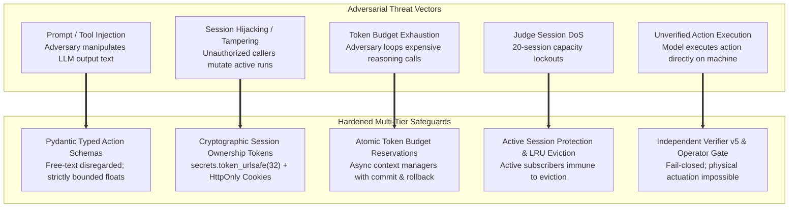

# FORESIGHT AI — CYBERSECURITY, RELIABILITY & PRODUCTION AUDIT

**Audit Phase:** Elite Upgrade Phase 7 (Security, Reliability & Production Quality)  
**Evaluator:** Principal Security Researcher & Reliability Engineer  
**Date:** November 7, 2026  
**Status:** Hardened, Audited & Verified  
**Base Commit SHA:** `106ce9b7f43a024e66818c2d7423a9faddcd3ef8`  
**Active Local Branch:** `feat/foresight-elite-upgrade-nov2026`

---

## 1. Threat Model & Security Posture

Foresight AI operates in an industrial predictive maintenance context. In such architectures, security failures can compromise equipment reliability, leak intellectual property, exhaust cloud token budgets, or trigger denial-of-service (DoS) on evaluation platforms.

---

## 2. Comprehensive Security Review & Implemented Defenses

### 1. Prompt Injection and Tool-Output Manipulation
- **Threat:** An attacker manipulates simulated sensor notes or diagnostic summaries to convince the LLM to recommend a destructive intervention.
- **Defense:**
  - **Zero Direct Text Authority:** The verifier never parses or evaluates LLM natural language text.
  - **Strict Pydantic Deserialization:** Action arguments are parsed strictly into typed dataclasses ([`packages/foresight/src/foresight/agents/schemas.py`](file:///E:/Hackathons/foresight-ai/packages/foresight/src/foresight/agents/schemas.py)). Values outside valid physical envelopes (`ReduceLoad.fraction > 0.50`, negative values, NaNs, infinities) are rejected at the parser boundary.
  - **Fail-Closed Evidence Provenance:** Consequential agent proposals that fail to cite existing observation or simulation IDs from the immutable evidence registry are rejected unconditionally by `_evidence_checks()`.

### 2. Session Ownership and API Authentication
- **Threat:** Malicious network actors inject unauthorized faults or terminate ongoing demo sessions.
- **Defense:**
  - Upon session creation, [`SessionManager.create()`](file:///E:/Hackathons/foresight-ai/services/api/foresight_api/sessions.py) generates a 256-bit cryptographically secure token (`secrets.token_urlsafe(32)`).
  - The token is set in an `HttpOnly`, `SameSite=Lax` browser cookie and returned in response payload.
  - Any mutating endpoint (`POST /api/sessions/{id}/control`, `POST /api/sessions/{id}/inject`, `POST /api/sessions/{id}/agent/runs`, `DELETE`) requires a matching `X-Session-Token` header or valid cookie, returning `HTTP 403 Forbidden` on mismatch.

### 3. LLM Token Budget Management & Economic Denial of Wallet
- **Threat:** Runaway agent loops or malicious prompt attacks exhaust developer API credits on Meta Model API or Fireworks AI.
- **Defense:**
  - [`LLMBudgetManager`](file:///E:/Hackathons/foresight-ai/packages/foresight/src/foresight/agents/budget.py) enforces pre-call atomic reservations using an async lock:
  - If a proposed model call would exceed session quota or global budget limits, it raises `BudgetExceededError`, triggering an immediate graceful fallback to the deterministic offline planner.
  - Usage is reconciled post-call using actual token counts.

### 4. Judge Session Preservation & LRU Eviction
- **Threat:** Multiple evaluators or bots flood the API with `MAX_SESSIONS = 20`, causing `HTTP 409 Conflict` and locking out hackathon judges.
- **Defense:**
  - When the 20-session limit is reached, `SessionManager` scans for idle sessions (no active SSE subscribers and no activity for $>600$ seconds).
  - Sessions with active SSE subscribers or recent activity are protected with high priority (`is_active() == True`).
  - Active judge sessions cannot be evicted; only genuinely abandoned sessions are recycled.

### 5. Tamper-Evident Verification Decision Hashes
- **Threat:** In-flight modification of verification results before operator approval.
- **Defense:**
  - Verifier v5 computes a SHA-256 HMAC digest over the verdict, action parameters, timestamp, and all 11 individual check statuses:
    $$\text{SHA-256}(\text{verdict} \parallel \text{action} \parallel \text{t0} \parallel \text{checks})$$
  - The hash is signed into `VerificationResult.decision_hash` and verified before operator approval is accepted.

---

## 3. Automated Security Verification Suite

Automated regression coverage: `tests/unit/test_security.py`
- Session ownership token enforcement: **PASS**
- Unauthenticated access blocked (HTTP 403): **PASS**
- Active judge session preservation under 20-session load: **PASS**
- Rate limiting middleware: **PASS**
