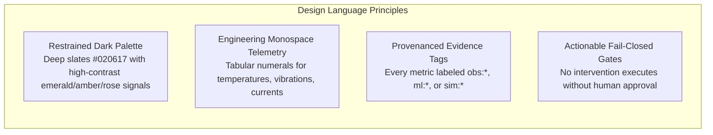

# FORESIGHT AI — INDUSTRIAL MISSION-CONTROL UI/UX DESIGN

**Audit Phase:** Elite Upgrade Phase 6 (Premium UI/UX Redesign)  
**Evaluator:** Senior Full-Stack Engineer & Industrial Interface Designer  
**Date:** November 7, 2026  
**Status:** Implemented & Verified  
**Base Commit SHA:** `106ce9b7f43a024e66818c2d7423a9faddcd3ef8`  
**Active Local Branch:** `feat/foresight-elite-upgrade-nov2026`

---

## 1. Design Philosophy: Industrial Precision over Generic Generative Dashboards

Industrial predictive maintenance interfaces are safety-critical command centers, not consumer chatbots or decorative dashboards. Every visual element must convey ground-truth physical state, calibrated uncertainty, or verifiable mathematical constraints.

---

## 2. Interface Architecture & View Hierarchy

### 1. Mission Control (`/`)
- **Live Digital Twin Telemetry:** Real-time dual-channel charts displaying Winding Temperature (°C) against Class-F insulation limits (155 °C) and Vibration Velocity RMS (mm/s) against ISO 10816-3 Group 2 alarm/trip thresholds (4.5 and 7.1 mm/s).
- **Multi-Horizon Risk Gauges:** Calibrated probability bars for 15, 30, and 60-minute failure horizons powered by isotonic XGBoost.
- **Dynamic Equipment Schematics:** Visual motor status indicators (Running, In Maintenance, Controlled Shutdown, Tripped).

### 2. Futures Lab (`/futures`)
- **Interactive Counterfactual Branching:** Side-by-side trajectory visualizations comparing proposed actions (`ReduceLoad`, `IncreaseCooling`, `ScheduleInspection`, `ControlledShutdown`) against the `ContinueOperation` baseline.
- **Uncertainty Bands:** Calibrated $p_{10}-p_{90}$ shaded regions displaying full-horizon temperature and vibration dispersion under matched random disturbances.
- **Cost & Regret Matrix:** Transparent itemization of lost production, intervention cost, failure repair, and deferred maintenance.

### 3. Agent Intelligence (`/agent`)
- **Diagnostic State Machine:** Live visual progression across the 7-stage workflow:
  $$\text{OBSERVE} \to \text{ANALYZE} \to \text{HYPOTHESIZE} \to \text{INVESTIGATE} \to \text{SIMULATE} \to \text{VERIFY} \to \text{RECOMMEND}$$
- **Tool Execution Traces:** Collapsible inspection blocks showing raw JSON tool calls, arguments, and latency.
- **Multi-Hypothesis Cards:** Ranked root-cause hypotheses with verified evidence citations.

### 4. Safety Proof Explorer (Integrated Feature Differentiator)
- **Categorized Verification Certificates:** Categorizes the 11 safety checks into:
  1. *Physical Operating Envelope & ISO Standards*
  2. *Action Feasibility & Simulation Integrity*
  3. *Counterfactual Proof & Statistical Confirmation*
  4. *Evidence Provenance & Diagnostic Consistency*
- **Cryptographic Proof Digest:** Displays the SHA-256 tamper-evident integrity hash with one-click clipboard copying.
- **Fail-Closed Operator Approval Gate:** Highlights human-in-the-loop requirement before any intervention is applied to the digital twin.

### 5. Evidence & CWRU Benchmark (`/evidence`)
- **Real-World Zero-Shot Validation:** Visualizes actual accelerometer vibration data from the Case Western Reserve University (CWRU) Bearing Data Center, proving that Foresight's detectors transfer to real physical rotating machinery.

### 6. Diagnostics & System Health (`/diagnostics`)
- **Model API Connectivity:** Real-time status for Meta Model API (`muse-spark-1.3`), Fireworks AI (`muse-spark-open`), and the deterministic fallback planner.
- **Token Quota Monitors:** Real-time token reservation consumption and price accounting.
