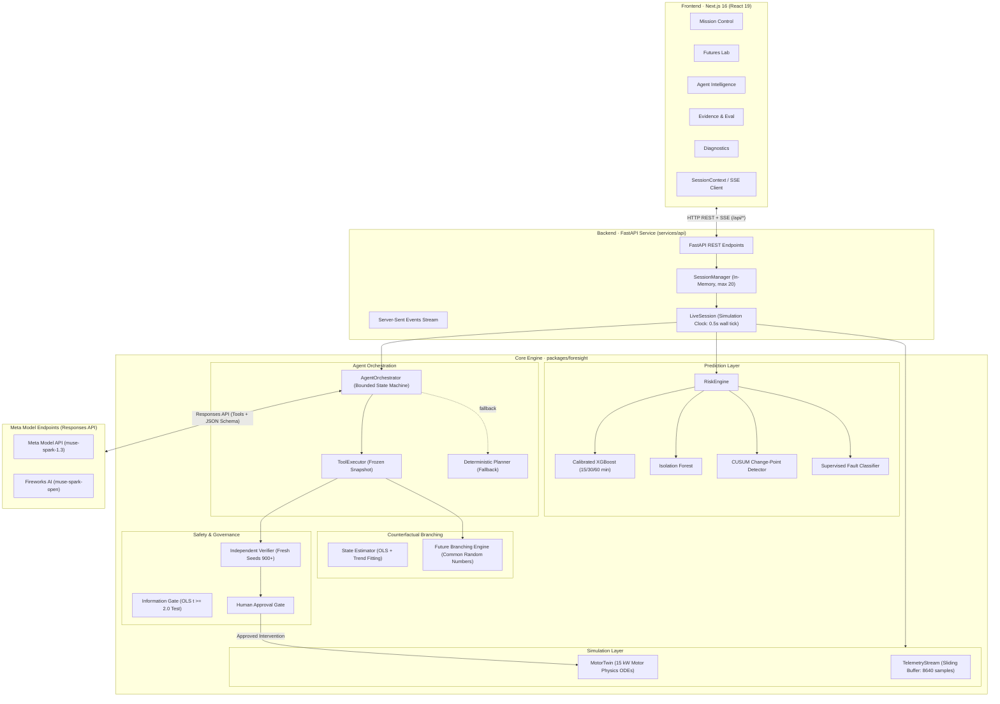

# FORESIGHT AI — ARCHITECTURE & CODE QUALITY REVIEW

**Audit Phase:** Phase 1 (Project Discovery) & Phase 2 (Code Quality and Architecture)  
**Evaluator:** Principal Software Engineer & AI Agent Systems Architect  
**Codebase:** `E:\Hackathons\foresight-ai`  
**Commit:** `8c3d04a`  

---

## 1. System Architecture Overview

Foresight AI is structured as a modular Python/TypeScript monorepo with strict architectural boundaries. The system separates non-deterministic AI reasoning from deterministic physics and safety verification.

### High-Level System Architecture Diagram



---

## 2. Main Execution Path: End-to-End Trace

The primary user journey from telemetry observation to verified intervention execution traces through seven discrete components:

```mermaid
sequenceDiagram
    autonumber
    actor User as Operator / Judge
    participant UI as Next.js Mission Control
    participant API as FastAPI (main.py)
    participant LS as LiveSession (sessions.py)
    participant TW as MotorTwin (twin.py)
    participant RE as RiskEngine (models.py)
    participant AO as AgentOrchestrator (orchestrator.py)
    participant LLM as Muse Spark (llm.py)
    participant FB as Future Branching (engine.py)
    participant VF as Verifier (verifier.py)

    User->>UI: Select Scenario (e.g. cooling_degradation, seed 7) : Start
    UI->>API: POST /api/sessions
    API->>LS: LiveSession.start() : spawns background _run() task
    loop Simulation Tick (every 0.5s wall time)
        LS->>TW: step(dt = speed * 0.5s)
        LS->>LS: stream.advance()
        opt Every 60 simulated seconds
            LS->>RE: assess(window)
            RE-->>LS: RiskAssessment (15/30/60m probabilities, fault diagnosis)
        end
        LS-->>UI: SSE event: "tick" (telemetry, assessment, risk history)
    end
    User->>UI: Click "Inject Fault"
    UI->>API: POST /api/sessions/{id}/inject
    API->>LS: inject_fault() (sets cooling fouling onset)
    Note over LS,TW: Temperature and failure risk rise
    User->>UI: Click "Run Diagnosis" (Meta or Fireworks)
    UI->>API: POST /api/sessions/{id}/agent/runs
    API->>LS: run_agent() : freezes AgentSnapshot : spawns AgentOrchestrator
    AO->>AO: Transition: OBSERVE : calls get_machine_state, get_sensor_history
    AO->>AO: Transition: ANALYZE : calls analyze_anomalies, predict_failure_risk
    AO->>AO: Transition: HYPOTHESIZE
    AO->>LLM: create_response(HYPOTHESIS_TASK, HYPOTHESIS_FORMAT)
    LLM-->>AO: Hypotheses + Candidate Interventions (Strict JSON)
    AO->>AO: Transition: INVESTIGATE
    AO->>LLM: create_response(INVESTIGATE_TASK, TOOL_DEFINITIONS)
    LLM->>AO: tool_call: compare_futures(actions)
    AO->>FB: compare_futures(actions, estimate)
    FB-->>AO: Branch outcomes (failure incidence, cost, p90 peaks)
    LLM->>AO: tool_call: submit_recommendation(action, claimed_mode, evidence_ids)
    AO->>VF: verify_independently(proposal, comparison)
    VF->>VF: Re-simulate proposal on 16 fresh seeds (base_seed=900)
    VF-->>AO: VerificationResult: accepted (all 11 checks pass)
    AO->>AO: Transition: VERIFY to RECOMMEND to DONE
    AO-->>LS: AgentTrace with verified recommendation
    LS-->>UI: SSE event: "agent" update
    UI->>User: Displays Verified Recommendation: "Inspection in 10 min" (Awaiting Approval)
    User->>UI: Click "Approve & Execute"
    UI->>API: POST /api/sessions/{id}/interventions (approved=true)
    API->>LS: apply_intervention()
    LS->>VF: Re-verify server-side
    LS->>TW: apply_action(ScheduleInspection)
    LS-->>UI: Intervention applied event; trajectory normalizes
```

---

## 3. Deep Dive into Architectural Components

### 3.1 Digital Twin (`packages/foresight/src/foresight/simulation/twin.py`)
- **Physics Model:** Single-node thermal ODE with exact analytic integration over each step:
  $$T(t + \Delta t) = T_{ss} + (T(t) - T_{ss}) e^{-\frac{G \Delta t}{C}}$$
  This eliminates numerical integration drift found in standard Euler approximations.
- **Cooling Dynamics:** The conductance $G$ scales with rotor speed:
  $$G = G_{rated} \cdot \left(f_{nat} + (1 - f_{nat}) \cdot \eta \cdot (\omega + \text{aux\_boost})\right)$$
  Crucially, slowing the motor at constant torque reduces fan cooling and exacerbates thermal rise.
- **Bearing Degradation:** Cubic load stress reflecting standard ISO/L10 life equations:
  $$\frac{dd}{dt} = k \cdot d \cdot L^3 \cdot \omega \cdot f(T)$$
- **Decoupled RNG Streams:** Spawns two distinct NumPy generators using `SeedSequence.spawn(2)`:
  - Stream 0: Process disturbances (load fluctuations, ambient drift via Ornstein-Uhlenbeck processes).
  - Stream 1: Sensor measurement noise.
  This allows counterfactual cloning where alternate interventions experience *identical* environmental disturbances (Common Random Numbers).

### 3.2 State Estimation & Future Branching (`packages/foresight/src/foresight/branching/`)
- **State Estimator ([estimation.py](../packages/foresight/src/foresight/branching/estimation.py#L1-L150)):** Infers unobservable latent states (cooling efficiency $\eta$, bearing damage $d$, process baseline load) from noisy telemetry using Ordinary Least Squares (OLS) regression over a 60-minute window. Reports standard errors for each fitted trend.
- **Branching Engine ([engine.py](../packages/foresight/src/foresight/branching/engine.py#L1-L180)):** Clones an ensemble of $N$ members (default 8) across $K$ candidate actions. Evaluates each member against an explicit economic objective:
  $$\text{Objective} = \text{Lost Production} + \text{Failure Repair} + \text{Downtime} + \text{Intervention} + \text{Deferred Maintenance} + \text{Terminal Risk Penalty}$$

### 3.3 Independent Safety Verifier (`packages/foresight/src/foresight/verification/verifier.py`)
- **Independence Guarantee:** The verifier does not trust the proposer's simulation ensemble. In `independent_confirmation` ([verifier.py#L184-L216](../packages/foresight/src/foresight/verification/verifier.py#L184-L216)), it constructs a fresh 16-member simulation from the same state using seed offset `CONFIRMATION_BASE_SEED = 900`.
- **Enforced Safety Checks:**
  1. `action_parameters_valid`: Parameter ranges strictly bounded.
  2. `simulation_complete`: Full horizon simulated from fresh state.
  3. `intervention_feasible`: Blower capacity $\le 40\%$, inspection lead time $\ge 15\text{ min}$ before earliest failure.
  4. `temperature_limit`: Ensemble $p90$ peak temperature $\le 140^\circ\text{C}$ (15 K below failure).
  5. `vibration_limit`: Ensemble $p90$ peak vibration $\le 6.1\text{ mm/s}$ (1 mm/s below trip).
  6. `load_range`: Continuous load $\le 1.15 \times \text{rated}$.
  7. `failure_risk`: Simulated failures $= 0.0$ across the ensemble.
  8. `improves_on_baseline`: Blocks consequential actions that fail to lower cost or prevent failure.
  9. `independent_confirmation`: Validates proposal against the verifier's own ensemble.
  10. `evidence_exists`: Verified evidence registry lookup for all cited IDs.
  11. `evidence_consistency`: Cross-checks claimed failure mode against current sensor features.

### 3.4 Information Gathering Gate (`packages/foresight/src/foresight/verification/information.py`)
- Evaluates whether an accepted consequential action is driven by premature trend extrapolations:
  - Tests trend slopes with standard error ($t = \frac{\text{slope}}{\text{SE}}$). If $t < 2.0$, trend is classified as unsupported.
  - Simulates a null future without unsupported trends. If safe, checks whether deferring the action by 15 minutes is proven failure-free under propagated uncertainty on fresh seeds (offset 950).
  - If both hold, the action is withheld with status `gather_information`.

---

## 4. Code Quality & Architectural Concerns

### 4.1 Strengths
1. **Zero Type Errors & Zero Lint Warnings:**
   - Python: Ruff check (`ruff check .`) ran across all 25+ modules and reported 0 issues.
   - Frontend: TypeScript compiler (`tsc --noEmit`) and ESLint (`eslint`) reported 0 errors.
2. **Defensive Error Handling:**
   - In `AgentOrchestrator.run()` ([orchestrator.py#L198-L211](../packages/foresight/src/foresight/agents/orchestrator.py#L198-L211)), execution is bounded by `asyncio.wait_for(timeout=300s)` and wraps all uncaught exceptions to record failure in the trace rather than crashing the FastAPI process.
3. **Immutability and Separation of Observables:**
   - `MotorTwin.true_outputs()` clearly separates `SensorReading` (observable by ML/agent) from `GroundTruth` (hidden simulator state used only for evaluation scoring).

### 4.2 Technical Debt & Architectural Fragilities
1. **Volatile In-Memory Session Storage ([sessions.py#L507-L552](../services/api/foresight_api/sessions.py#L507-L552)):**
   - Sessions exist exclusively in a Python dictionary `self.sessions: dict[str, LiveSession]`. Server restarts discard all active twins, history, and agent traces.
2. **Race Window in Busy State Locking ([sessions.py#L332-L349](../services/api/foresight_api/sessions.py#L332-L349)):**
   - Session methods check `if self.busy:` and set `self.busy = "..."` without acquiring an `asyncio.Lock()`. Simultaneous async requests can pass the check before either sets the flag.
3. **GIL Contention During Simulation:**
   - `compare_futures` runs in a thread pool via `asyncio.to_thread`. Because Python threads share the Global Interpreter Lock, running multiple 16-member or 32-member simulations concurrently will cause event-loop lag for HTTP requests.
4. **Windows CLI Invocation Glitch:**
   - `uv run pytest` fails on Windows PowerShell with `error: uv trampoline failed to canonicalize script path`. Direct invocation via `.venv\Scripts\python -m pytest` is required.
