# FORESIGHT AI — PRIORITIZED ENGINEERING ROADMAP

**Audit Phase:** Phase 9 (Innovation and Improvement Opportunities) & Phase 10 (Deliverables)  
**Evaluator:** Principal Software Engineer & Product Architect  
**Codebase:** `E:\Hackathons\foresight-ai`  
**Target Submission Deadline:** November 4, 2026, 9:00 PM Eastern  

---

## 1. Roadmap Horizon Matrix

```mermaid
flowchart LR
    subgraph H1["Immediate (0-12 Hours)"]
        direction TB
        T1["Tail-Risk Verifier Hardening (N=32)"]
        T2["LRU Session Eviction"]
        T3["API Rate Limiting"]
    end

    subgraph H2["Next 24 Hours"]
        direction TB
        T4["API Key Token Auth"]
        T5["Async Lock on LiveSession"]
        T6["CWRU Bearing Benchmark Harness"]
    end

    subgraph H3["Next 72 Hours"]
        direction TB
        T7["SQLite / PostgreSQL Persistence"]
        T8["Adaptive Ensemble Sizing"]
        T9["Multi-Asset Mission Control"]
    end

    subgraph H4["Post-Hackathon"]
        direction TB
        T10["Physics-Informed Neural ODEs"]
        T11["Live Industrial Modbus/MQTT Bridge"]
    end

    H1 --> H2 --> H3 --> H4
```

---

## 2. Category A: Critical Engineering Fixes (Security & Correctness)

### Upgrade 1: Close the 16-Member Tail-Risk Verifier Blind Spot
- **Problem Being Solved:** An adversarial Meta Muse Spark model discovered a 35% load cut on bearing fault that passed 16-member confirmation but failed 1/48 in audit (~2.1% failure rate, which escapes $N=16$ with >70% probability).
- **Evidence:** Documented in `artifacts/reports/redteam_v4.md` (Lines 50–55).
- **Proposed Implementation:**
  1. Increase `SafetyPolicy.confirmation_members` from 16 to 32 (or adaptively 48 for bearing proposals).
  2. In `_check_confirmation` ([verifier.py#L218-L255](../packages/foresight/src/foresight/verification/verifier.py#L218-L255)), compute the upper Wilson confidence bound: if upper 95% CI of failure incidence exceeds 0.10, require a larger confirmation sample.
- **Technical Architecture:** Changes contained strictly in `verifier.py`.
- **Complexity:** Low (≈15 lines of code).
- **Expected Benefit:** Zero hard escapes in red-team round 4; mathematical tail-risk escape probability reduced from 71.2% to $<10\%$.
- **Risks & Tradeoffs:** Increases verification re-simulation compute time by ~300 ms.
- **Acceptance Criteria:** `scripts/run_red_team.py --verifier v5 --attackers meta:high` reports 0 hard escapes on `bearing_deterioration@120min/s7`.
- **Priority:** **P0 (Immediate Fix)**

---

### Upgrade 2: LRU Session Eviction & Rate Limiting on Session Creation
- **Problem Being Solved:** `MAX_SESSIONS = 20` causes complete DoS when 20 sessions are created, rejecting subsequent requests with HTTP 409.
- **Evidence:** `sessions.py` Line 42 and Lines 515–517.
- **Proposed Implementation:**
  In `SessionManager.create()` ([sessions.py#L513-L528](../services/api/foresight_api/sessions.py#L513-L528)), if `len(self.sessions) >= MAX_SESSIONS`, automatically identify and `await self.delete(oldest_session_id)` based on `session.last_active` monotonic timestamp.
- **Complexity:** Very Low (≈10 lines of code).
- **Expected Benefit:** Prevents DoS lockouts; eliminates user-facing HTTP 409 errors during public demo.
- **Acceptance Criteria:** A script creating 25 consecutive sessions succeeds on all 25 calls, maintaining the 20 most recent sessions active.
- **Priority:** **P0 (Immediate Fix)**

---

### Upgrade 3: Basic API Security & LLM Token Protection
- **Problem Being Solved:** Anyone on the local network can trigger unauthenticated agent runs or model checks, consuming user API tokens.
- **Evidence:** `main.py` Lines 87–94.
- **Proposed Implementation:**
  Add optional `FORESIGHT_API_KEY` in `.env`. If set, validate `Authorization: Bearer <key>` on mutating POST/DELETE endpoints via a FastAPI dependency.
- **Complexity:** Low (≈25 lines in `main.py`).
- **Expected Benefit:** Prevents unauthorized token consumption during shared or cloud hosting.
- **Priority:** **P1 (Next 24 Hours)**

---

## 3. Category B: High-Impact Product Improvements (Judge Confidence)

### Upgrade 4: Real-World Dataset Validation Benchmark (CWRU Bearing Data)
- **Problem Being Solved:** Skeptical judges will argue that Foresight AI is tested purely on its own synthetic digital twin.
- **Evidence:** `README.md` Line 176; `evaluation.md` Section 8.
- **Proposed Implementation:**
  Create an offline validation script `scripts/benchmark_cwru.py` that streams real vibration accelerometer data from the Case Western Reserve University (CWRU) Bearing Data Center into `RiskEngine.assess()`. Validate that the CUSUM and Isolation Forest detectors flag actual ball/inner-race faults with zero false alarms on healthy baseline runs.
- **Complexity:** Medium (≈150 lines of Python).
- **Expected Benefit:** Completely defarms the "it's only a toy simulator" objection during judge evaluation.
- **Priority:** **P1 (Next 24 Hours)**

---

### Upgrade 5: SQLite Session & Trace Persistence
- **Problem Being Solved:** Server restart destroys all running twins, historical risk trends, and agent traces.
- **Evidence:** `SessionManager` stores state solely in `dict[str, LiveSession]`.
- **Proposed Implementation:**
  Integrate a lightweight SQLite database (`foresight.db`) with `aiosqlite`. Persist session metadata, completed agent run traces, and verification logs.
- **Complexity:** Medium (≈180 lines of Python).
- **Expected Benefit:** Enables historical audit review, persistent agent runs, and multi-day demonstration continuity.
- **Priority:** **P2 (Next 72 Hours)**

---

## 4. Category C: Advanced Innovations (Research Frontier)

### Upgrade 6: Physics-Informed Neural ODE (PINN) State Estimator
- **Problem Being Solved:** The current state estimator uses linear OLS regression on sensor trends. When non-linear thermal-vibration coupling occurs, OLS underestimates parameter covariance.
- **Proposed Implementation:**
  Train a lightweight Physics-Informed Neural Network (PINN) surrogate that takes 30-minute sensor trajectories and outputs latent parameters $(\eta, d, L_{base})$ with Bayesian uncertainty bounds.
- **Complexity:** High (Requires PyTorch / JAX).
- **Expected Benefit:** Pushes the research frontier in digital twin parameter estimation; directly aligns with the "Push the Frontier" hackathon theme.
- **Priority:** **P3 (Post-Hackathon)**

---

## 5. Execution Schedule: Countdown to November 4 Deadline

| Milestone | Target Completion | Key Deliverable | Owner |
| :--- | :--- | :--- | :--- |
| **Milestone 1** | T + 6 Hours | Implement Verifier v5 ($N=32$ confirmation) + LRU session eviction | Senior Engineer |
| **Milestone 2** | T + 18 Hours | Run CWRU Bearing Data benchmark & add results to `docs/` | AI/ML Engineer |
| **Milestone 3** | T + 30 Hours | Record 3-minute video adhering to `docs/demo-script.md` | Product Architect |
| **Milestone 4** | T + 48 Hours | Deploy demo to cloud VM (e.g. AWS/Fly.io) with Bearer token protection | DevOps Engineer |
| **Milestone 5** | November 4, 12:00 PM | Final Cerebral Valley submission submission review & freeze | All |
