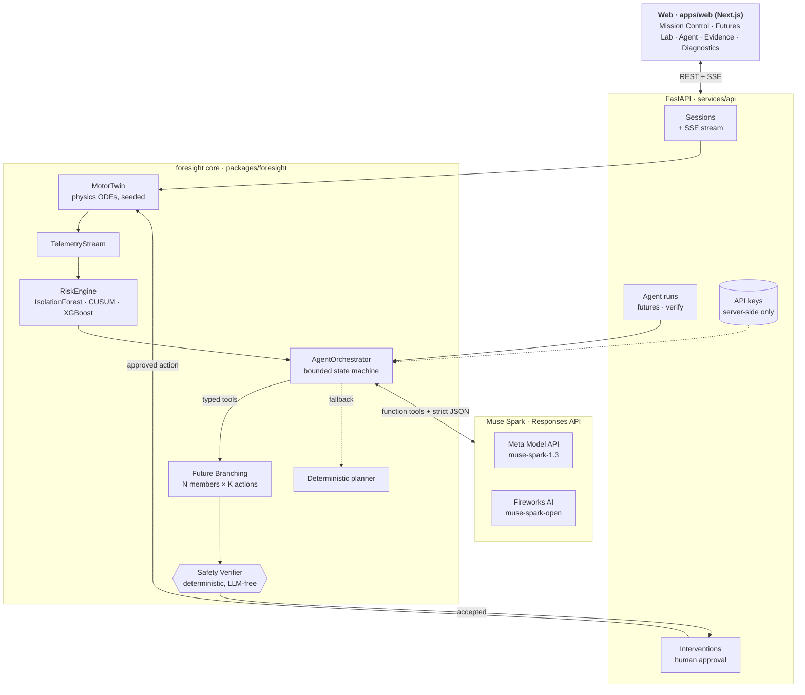
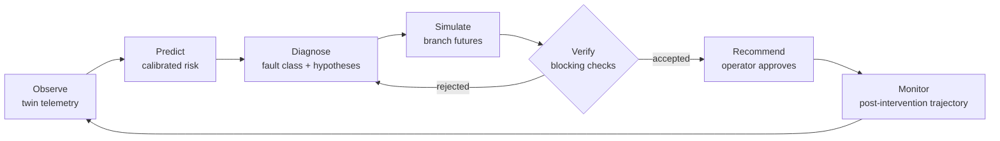
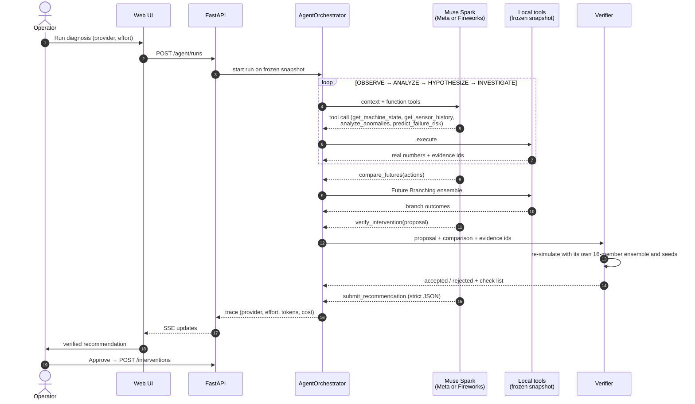
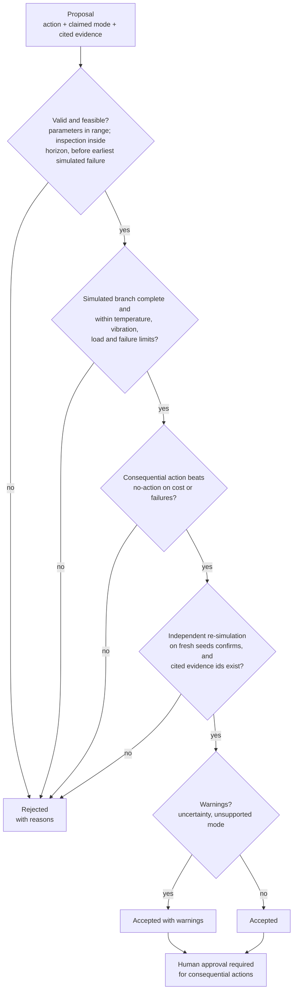
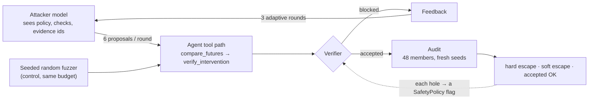

# Foresight AI — Architecture

**Tagline:** See the failure before it happens. Simulate the future. Prevent the outcome.

Foresight AI is a simulation-only industrial intelligence loop:

**Observe → Predict → Diagnose → Simulate → Verify → Recommend → Monitor**

It never connects to or controls real equipment. All telemetry comes from a deterministic digital twin of a 15 kW TEFC induction motor driving a conveyor load.

## System diagram

The browser never sees an API key. Every number the agent reasons about comes from a tool call into local code, and nothing reaches the twin without passing the verifier and an operator approval.

## Closed loop

## One agent run

If the model never submits a verified recommendation within the budget, or no key is configured, the deterministic planner picks the action and the trace says so.

## Verifier decision

## Red-team loop

## Layers

### 1. Digital twin (`foresight.simulation`)

Physics-inspired ODE model with:

- Lumped thermal node (exact linear ODE step)
- Bearing damage growth (cubic load dependence inspired by L10 life)
- Vibration from baseline + bearing defect
- Cooling efficiency / overload / inspection / shutdown actuators
- Two RNG streams (process vs sensor) so cloned branches share matched disturbances

Scenarios: `cooling_degradation`, `bearing_deterioration`, `overload`, plus healthy baseline.

### 2. Telemetry (`foresight.telemetry`)

Timestamped samples, rolling window, missing/invalid handling, deterministic replay, simulation time separated from wall clock.

### 3. Prediction (`foresight.prediction`)

- Isolation Forest anomaly detection
- CUSUM change-point detection
- Multi-horizon XGBoost failure-risk models with isotonic calibration
- Supervised fault-class diagnosis
- Explicit baselines (z-score, alarm thresholds, temperature extrapolation)

Training / validation / test use disjoint seed ranges. See `artifacts/reports/evaluation.md`.

### 4. Future Branching (`foresight.branching`)

From a frozen estimated (or oracle) state, clone N members × K interventions, simulate a shared horizon with common random numbers, score an explicit economic objective, and rank branches. Estimates are **not** claimed causal effects.

### 5. Verification (`foresight.verification`)

Deterministic, LLM-independent policy checks on typed proposals + branch outcomes. Can reject unsafe or incomplete recommendations. Consequential actions always require human approval in the live UI.

The verifier does not trust the proposer's ensemble alone. The proposer chooses which actions to simulate, so an action can look safe because its small (8-member) ensemble happened to avoid failure. Before accepting, the verifier re-simulates the proposed action from the same initial state with its own 16-member ensemble and seeds the proposer never sees (`independent_confirmation`, blocking). The proposer's comparison and the confirmation must both show no failures and stay within the temperature and vibration limits.

Operator commands sent without a comparison bypass the verifier and are logged as "not verified", so the operator keeps authority.

**Fixes found by the red-team.** Each fix is a `SafetyPolicy` flag, so earlier versions can be reproduced (`run_red_team.py --verifier v1|v2|v3|v4`).

| Version | Change | Hole it closes |
|---|---|---|
| v1 | original | — |
| v2 | `improves_on_baseline` blocks a consequential action that neither lowers the objective nor the failure incidence (`block_no_benefit`) | wasteful actions on a healthy machine passed with a warning |
| v3 | vibration p90 limit 1 mm/s below the trip (6.1 mm/s); a tie with doing nothing is not a benefit; an inspection must start inside the simulated horizon (`strict_improvement`) | an untested load cut with p90 vibration just under the trip failed 1/48 in the audit; inspections scheduled after the horizon tied the no-action objective |
| v4 | inspection lead time measured from the baseline's *earliest* simulated failure, not the median (`inspection_before_earliest_failure`) | late bearing inspections (40–45 min) let early-failing members fail first (1–2/48 in the audit) |

v4 is the default in code. It has a regression test but has **not** been red-teamed or re-evaluated yet, so all reported numbers come from v1–v3.

**Red-team** (`foresight.evaluation.redteam`, `scripts/run_red_team.py`): an attacker model (Muse Spark Open on Fireworks, or Muse Spark 1.3 on Meta) sees the safety policy, the check list and the real evidence ids. It proposes interventions it expects to pass while being unsafe, wasteful or backed by fabricated evidence, and adapts over three rounds using the verifier's feedback. Proposals go through the agent's own tool path. Every accepted proposal is audited with a 48-member ensemble on fresh seeds. A seeded random fuzzer with the same budget is the control. Escapes are judged against the same twin (a larger ensemble with fresh seeds), not against ground truth.

### 6. Agent (`foresight.agents`)

Bounded state machine: OBSERVE → ANALYZE → HYPOTHESIZE → INVESTIGATE → SIMULATE → VERIFY → RECOMMEND.

- Live path: Responses API with function tools + structured output, from either provider through one `ModelClient`. The options are Meta Model API (`muse-spark-1.3`) and Fireworks AI (`muse-spark-open`). Provider and reasoning effort are chosen per run and recorded in the trace, and cost uses each provider's prices, including Fireworks cached-input pricing.
- Fallback: deterministic planner (clearly labelled in traces)
- Tools never invent sensor or simulation numbers; they call local code on a frozen snapshot
- `inspect_visual_evidence` returns `unavailable` until a real camera source exists (no fake vision)

### 7. API (`foresight_api`)

FastAPI + SSE streams. MODEL_API_KEY and FIREWORKS_API_KEY stay server-side. Diagnostics expose provider connectivity without leaking secrets.

### 8. Web (`apps/web`)

Next.js App Router + Tailwind + Recharts. Screens: Mission Control, Future Branching Lab, Agent Intelligence, Evidence & Evaluation, Diagnostics.

## Evidence provenance

UI and schemas distinguish:

| Kind | Meaning |
|------|---------|
| Observed | Twin sensor channels (synthetic measurements) |
| ML prediction | Calibrated model outputs |
| Simulation estimate | Branch outcomes / state estimate |
| LLM hypothesis | Agent free-text / structured hypotheses |
| Verified | Passed the independent verifier |

## Safety posture

- Simulation only
- No shell tools for the LLM
- No direct equipment control
- Human approval gate for interventions
- Visual / SAM path disabled until real evidence exists
